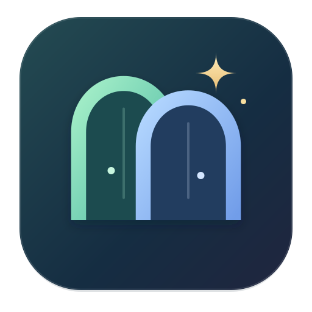

# Portio for Mac

[日本語](README.md) | **English**

**Two workspaces. One place to begin.**

Portio is a small Mac browser with separate personal and university sessions. Switch spaces and open Gmail, Drive, Calendar, Canva or Classroom without preparing another browser window. Its name is an original word inspired by magical travel between places.

## Why I made it

When I asked ChatGPT to operate websites, separate browsers for my personal and university accounts crowded my screen. I also wanted to avoid signing up for another service, so I made Portio to bring both workspaces into one app. Portio itself requires no account registration.

## Features

- Separate cookies and website storage for each space.
- Service shortcuts, an address/search field and tabs. Add your own websites separately in each space.
- Drag tabs to reorder them, preserving the current page and its input. Restore their order and selection after restarting; authentication callback URLs are excluded.
- Save logins separately in each space. Click a login field and choose an account, then verify with Touch ID to fill its username and password.
- Free to use. Third-party services may have their own fees.

## Use on a Mac

**This repository currently distributes source code.** A ready-to-install app binary is not published on GitHub. Follow the build instructions below to create `Portio.app` on your own Mac.

The prototype targets **Apple Silicon (M1 or later)** and was checked on macOS 15.3.2. Intel Macs are untested. Move the locally built app to Applications, then sign in separately in each space. The local build is ad-hoc signed, without Apple Developer ID signing or notarization.

Quit Portio before replacing the app when updating. Sign in separately from Chrome or Safari.

## Shortcuts

⌘1 / ⌘2: switch space · ⌘T / ⌘W: new / close tab · ⌘L: address · ⌘R: reload · ⌘Q: quit.

Use **「＋ 追加」** beside 「すぐに開く」 to save a name and an `https://` or `http://` URL. Each space supports up to 20 custom shortcuts. Use **「…」** beside an added item to edit or delete it. Deleting a shortcut keeps its open page intact.

Use **「＋」** immediately after the open tabs to add a new tab. The button remains visible when tabs overflow, and the newly opened tab scrolls into view.

Drag a tab title left or right to change its position.

Notification allow/block choices are remembered separately for each website origin and space. Open **「サイトの通知」** in the sidebar to review or reset a choice. Reload the site after resetting; its next notification request will ask again. If no choice is saved, Portio asks when the site first requests notifications. Camera, microphone and clipboard permissions are valid only until the app exits.

## Save and fill passwords

1. Enter your username and password, then attempt to sign in.
2. Portio asks whether to save the login. Check the site, account and entered information, then choose **「保存する」**. Identical saved credentials do not trigger another prompt.
3. Next time, click a login field, choose the saved account and verify with **Touch ID**. Portio fills the fields without submitting the form.

Each fill, update of an existing entry, and deletion requires a fresh Touch ID check. Cancellation, failure or unavailable Touch ID stops the operation. Macs without configured Touch ID cannot use saved-logins filling; manual site entry remains available.

If a site does not trigger the prompt, use the key button and **「＋ このサイトのログインを保存」**. The prompt detects a sign-in attempt; it does not verify successful authentication. For multi-step sign-in, select the same account in each step. Matching requires the exact origin (scheme, host and port) and space. Ordinary HTTPS login forms are supported; embedded frames and some custom forms are not. Verification codes and passkeys still require their usual actions. Delete unwanted entries from **「パスワード」**.

Type part of a previously visited site's title or URL in the address bar to see suggestions. Click a candidate, or use arrow keys and Enter. Each space keeps up to 200 recent sites locally across restarts; the sidebar can clear that space's history. Authentication pages, query strings and URL fragments are excluded from this candidate history. Typed prefixes are not sent to a search service.

## Limits and privacy

- Built with Electron and Chromium; it is not Google Chrome.
- Google or university SSO may reject embedded browsers. Portio does not bypass those restrictions.
- **No automatic updates.** Install a newer Portio build to receive browser security fixes.
- No extensions, Chrome sync or password import from Chrome/iCloud.
- Touch ID guards the saved-login operation, not already signed-in tabs or passwords after they reach the website. No independent security audit has been performed. See the [review and remaining limits](docs/SECURITY-REVIEW.md).
- Spaces separate sign-ins; they do not hide data from another person using the same Mac account.
- Websites communicate directly with their own services. Portio adds no analytics, ads or cloud sync.
- Saved login credentials are encrypted locally using a key protected by the macOS Keychain. They are not synced to an external service.
- Sign-in sessions, website storage, restored tabs, custom shortcuts, notification choices and address-bar history are saved locally on your Mac. Published source code does not include users' accounts, cookies or browsing history.

See [validation and known limits](TESTING.md).

## Build from source

Requires macOS, Node.js 22.12+ and npm. The first Electron download requires an internet connection.

```sh
git clone https://github.com/xhan21/portio.git
cd portio
npm ci
node node_modules/electron/install.js
npm test
npm run package
```

Output: `dist/Portio-darwin-arm64/Portio.app`. The build script applies and verifies an ad-hoc signature. Edit `resources/Portio.svg` and run `npm run icon` to regenerate the icon.

[Maintenance](docs/MAINTENANCE.md) · [Changelog](CHANGELOG.md) · [Tools made with Hedwig](https://github.com/xhan21/hedwig-tools/blob/main/README.en.md)

Source and original icon: [MIT](LICENSE). Electron, Chromium and other dependencies retain their own licenses, included with the generated Mac build.
