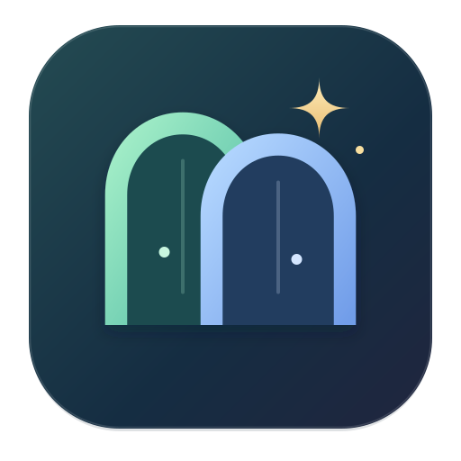

# Portio（ポルティオ）

**日本語** | [English](README.en.md)

**個人と大学、ふたつの作業場所をひとつのアプリに。**

個人用と大学用のログイン状態を分けて使える、Mac用の小さなブラウザです。
左側で「個人」「大学」を選び、Gmail・Drive・カレンダー・Canva・Classroomを開けます。
Portioは、場所を行き来する魔法をイメージした造語です。

## 作った理由

ChatGPTにウェブ操作を頼む際、個人用と大学用に開いたブラウザで画面がいっぱいになるのが気になっていました。新しいサービスへの登録も増やしたくなかったので、ふたつの作業場所をひとつにまとめるPortioを作りました。Portio自体のユーザー登録は不要です。

## できること

- **ログインを分ける**：個人・大学それぞれに、Cookieとサイトの保存領域を用意。
- **すぐ始める**：よく使うサービスへの入口と、URL・検索の入力欄。自分で好きなサイトも追加できます。
- **タブを並べ替える**：タブを左右にドラッグして移動。順番と選択中のタブをスペースごとに保存し、再起動時に復元。
- **ログイン情報を保存する**：入力欄をクリックし、保存したアカウントを選び、Touch IDで本人確認するとIDとパスワードを入力。個人用・大学用を分けて保存します。
- **無料で使う**：Portio自体の利用料や月額料金はありません。各Webサービスの料金は別です。

## Macで使う

**現在はソースコードを公開しています。** ダウンロードしてすぐ使えるアプリ本体はGitHubでは配布していません。下の「ソースから作る」で、手元のMacに `Portio.app` を作成できます。

作成対象は **Apple Silicon（M1以降）** です。macOS 15.3.2で確認しています。Intel Macでの動作は未確認です。

作成した `Portio.app` を「アプリケーション」へ移動し、「個人」「大学」でそれぞれ目的のアカウントにログインしてください。
ローカルビルドはアドホック署名です。AppleのDeveloper ID署名・公証はしていません。

更新時はPortioを終了してからアプリを入れ替えてください。ChromeやSafariとは別にログインが必要です。

## 使い方

| 操作 | ショートカット |
|---|---|
| 個人へ切り替え | ⌘1 |
| 大学へ切り替え | ⌘2 |
| 新しいタブ／タブを閉じる | ⌘T／⌘W |
| URL・検索の入力 | ⌘L |
| 再読み込み | ⌘R |
| 終了 | ⌘Q |

スペースの切り替えは、同じサイト内のGoogleアカウント選択とは別の操作です。最初に適切なスペースを選んでからログインしてください。

「すぐに開く」の **「＋ 追加」** から、名前とURL（`https://` または `http://` で始まるアドレス）を登録できます。個人用・大学用それぞれ20件まで保存でき、追加した項目の **「…」** から編集・削除できます。項目を削除しても、開いているページは閉じません。

タブのすぐ右隣の **「＋」** から、新しいタブを開けます。タブが多い場合もボタンは表示され、新しく開いたタブまで自動でスクロールします。

タブのタイトルを左右にドラッグすると順番を変えられます。移動しても表示中のページや入力内容はそのままです。

通知の「許可する／許可しない」は、サイトごと・スペースごとに保存します。サイドバーの **「サイトの通知」** で保存済みの選択を確認・リセットできます。リセット後に対象ページを再読み込みすると、サイトが通知を求めたときに選び直せます。選択が保存されていないサイトでは、初回の通知リクエスト時に確認します。カメラ・マイクやクリップボード等の許可は、アプリ終了まで有効です。

### アドレス欄の候補

以前開いたサイトの名前やURLをアドレス欄に入力すると、候補が表示されます。クリック、または↓／↑とEnterで開けます。Escで閉じます。履歴は個人用・大学用それぞれ直近200件をMac内に保存し、再起動後も利用できます。「このスペースのアクセス履歴を消去」で消去できます。認証用のページやURLのクエリ・フラグメントは候補用の履歴に残しません。検索サービスへ入力中の文字を送信する機能はありません。

### パスワードを保存して使う

1. サイトのログイン画面でIDとパスワードを入力し、ログイン操作をします。
2. Portioから **「ログイン情報を保存しますか？」** と案内します。サイト・アカウント名と入力した情報を確認し、**「保存する」** を選びます。同じ情報が保存済みなら再度聞きません。
3. 次回から、そのサイトの入力欄をクリックしてアカウントを選び、**Touch IDで本人確認**すると入力されます。ログインボタンは自分で押します。

保存情報による入力・既存情報の更新・削除には、その都度Touch IDが必要です。認証できない場合・キャンセルした場合は処理しません。Touch IDのないMacや未設定のMacでは、この機能による入力は使えません。サイトへの手入力は引き続き使えます。

保存の案内が出ないサイトでは、右上の鍵ボタン→「＋ このサイトのログインを保存」から登録できます。案内はログイン操作を検出して表示するもので、ログインの成功を判定するものではありません。IDとパスワードが別画面のサイトでは、それぞれの入力欄で同じアカウントを選びます。保存先はサイトのアドレス（通信方式・ホスト名・ポート）とスペースが完全に一致する場合に限ります。HTTPSの通常のログインフォームに対応し、埋め込みフォームや一部の独自フォームには対応しません。確認コードやパスキーの操作は従来どおり必要です。不要な情報は「パスワード」の一覧から削除できます。

## 知っておきたいこと

- Chromiumを含むElectronで動きます。Google Chromeそのものではありません。
- Google・大学のSSOなど、認証方式によって利用できない場合があります。サービス側の埋め込みブラウザ制限を回避する機能はありません。
- ブラウザの**自動更新はありません**。セキュリティ修正を取り込むには、新しいPortioへ更新してください。
- 拡張機能、Chrome同期、Chrome・iCloudからのパスワード取り込みは未実装です。
- ふたつのスペースはログインを分けるためのもので、同じMacを使う別の人から情報を隠す機能ではありません。
- Touch IDは保存情報の入力操作を保護します。ログイン済みのタブや、サイトに入力した後のパスワードを隠すものではありません。第三者の安全性監査は未実施です。[今回の点検と残る制約](docs/SECURITY-REVIEW.md)を参照してください。
- [動作確認と未確認の範囲](TESTING.md)を参照してください。

## データの扱い

閲覧したサイトへの通信は、そのサイトに直接送られます。Portio独自の解析・広告・クラウド同期はありません。
ログイン状態、サイトの保存データ、復元用タブ、追加した「すぐに開く」の項目、通知の選択、アドレス欄の候補用アクセス履歴は、お使いのMac内に保存します。
保存したログイン情報は、Macのキーチェーンで保護された鍵を使って暗号化し、このMac内に保存します。外部への同期は行いません。
公開するソースコードに、利用者のアカウント・Cookie・閲覧履歴は含めません。

## ソースから作る

macOS、Node.js 22.12以降、npmが必要です。Electronの初回取得にはネット接続が必要です。

```sh
git clone https://github.com/xhan21/portio.git
cd portio
npm ci
node node_modules/electron/install.js
npm test
npm run package
```

作成先は `dist/Portio-darwin-arm64/Portio.app` です。ローカルでもアドホック署名を検証します。
アイコンの原本は `resources/Portio.svg`。変更後は `npm run icon` でPNG・ICNSを再生成できます。

開発・更新の注意点は [MAINTENANCE.md](docs/MAINTENANCE.md)、変更内容は [CHANGELOG.md](CHANGELOG.md) にまとめています。

[Hedwigとつくる道具 — シリーズ紹介](https://github.com/xhan21/hedwig-tools)

ソースコードと独自のアイコンは [MITライセンス](LICENSE)。Electron・Chromium等には、それぞれのライセンスが適用されます。生成したMac版には、ElectronとChromiumのライセンスを同梱します。
